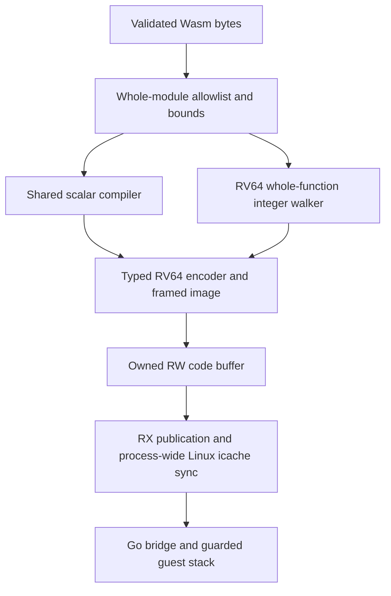

# Reading the experimental RV64 port

This checkpoint runs a bounded integer Wasm subset using real Linux/RV64 code.
It begins with the shared compiler interface merged in #802, adds an encoder and
isolated runtime, then expands through integer control, memory/globals, bulk data
and direct recursion. It is ready for staged code review; it does not expose a
production Wago target or claim full Wasm parity.

## The route from Wasm to execution

Start in [module.go](../../src/core/compiler/backend/railshot/riscv64/module.go).
Compile snapshots the input, decodes and validates normally, then admits the
entire module before any function emits code. This includes hidden functions
and dead instructions: an unsupported function cannot enter an otherwise callable
instance. Plain integer signatures still require exactly one result.

Each admitted function uses the existing
[shared scalar compiler](../../src/core/compiler/backend/railshot/shared/scalar.go)
when its admission rules allow it. Remaining supported functions use the RV64
[integer walker](../../src/core/compiler/backend/railshot/riscv64/integer.go).
That walker is genuine RV64 lowering, with canonical operand homes and bounded
control metadata. Unsupported shapes fail before executable publication. There
is no AMD64/ARM64 machine-code substitution.

The [encoder](../../src/core/encoder/riscv64/asm.go) builds fixed 32-bit little-endian
RV64I/M instructions. Constants need at most eight instructions. Long transfers
use fixed AUIPC/JALR envelopes, with image-relative fixups completed before
publication. No compressed instructions or optional bit/vector extensions are
needed for the emitted guest subset.

## What the 19 hooks do

The RV64 [target](../../src/core/compiler/backend/railshot/riscv64/scalar.go)
implements these existing shared hooks. Shared code owns values, aliases, deferred
expressions, spills and structured agreements; the target supplies physical
instructions and framed addresses.

| Hook | How to read its RV64 role |
| --- | --- |
| Registers | Returns usable physical registers and the reserved mask. |
| ParameterRegister | Returns false; entry first copies parameters to frame homes. |
| LocalOffset | Finds an eight-byte local home after the frame header. |
| SpillOffset | Finds operand/agreement homes after all locals. |
| Constant | Emits full i64 or zero-normalized i32 carriers. |
| Move | Copies i64; copies and normalizes i32, including aliases. |
| NormalizeI32 | Clears upper bits with baseline shifts. |
| Load | Uses LD or LWU, with reserved scratch for large offsets. |
| Store | Uses SD or SW at the canonical home. |
| Clobbers | Declares the permanently reserved scratch used by sequences. |
| Operand | Accepts register operands; other operand forms are declined. |
| Binary | Emits integer arithmetic/comparisons with Wasm width semantics. |
| ScaledAdd | Returns false in this checkpoint. |
| BranchZero | Tests the low i32 word even with dirty incoming upper bits. |
| BranchCompare | Emits the false edge of the requested comparison. |
| Jump | Emits a fixed long noncalling transfer. |
| Patch | Patches a checked image-relative envelope without relaxation. |
| Position | Returns the current byte offset. |
| Return | Normalizes and writes the fixed serialized result cell. |

One important example is i32 `0xffffffff + 1`. An RV64 ADDW sign-extends its
32-bit result, while shared i32 carriers require zero upper bits. More generally,
an incoming carrier may be `0xfeedfaceffffffff`: unsigned comparisons must read
`0xffffffff`, and signed comparisons must read `-1`. The target handles widths
in arithmetic, comparisons, branches, moves, loads, stores and returns. Calling
NormalizeI32 only at the end would leave earlier consumers incorrect.

## Values, spills and frame homes

For `local.get x; local.get y; i32.add`, shared code can retain references or
defer the expression until a consumer needs it. It materializes into a usable
register and invokes Binary. Aliases remain logical references to the same
value; changing a local must not change an older stack reference.

Under pressure, shared code moves values to agreement/spill homes and later
reloads them. The fallback walker instead stores every live operand in a
canonical home, using a small fixed set of temporary registers. This makes
calls and control edges easy to audit, at the cost of optimization. The
`pressureFixture` regression has 256 locals and 48 live values, forcing real
spills and reloads beyond a signed 12-bit displacement. Large homes use reserved
address scratch, rather than truncating offsets or stealing a live register.

A noncalling frame starts with saved RA at offset 0 and the result pointer at 8.
Locals begin at 16; operand homes follow them. A calling frame has a 48-byte
header, so local `i` is at `48 + 8*i` and operand home `j` at
`48 + 8*nlocals + 8*j`. All frame sizes are rounded to 16-byte alignment. Entry
checks the stack fence and full frame capacity before SP adjustment or any write.

## The three ABI boundaries

The [bridge](../../src/core/runtime/riscv64/entry_linux_riscv64.s) adapts Go ABI0
entry to the guest convention. Go's register/stack conventions are not the
guest convention, and the Linux syscall ABI is another contract. The bridge
preserves Go SP/RA, GP/TP, saved registers and Go CTXT/g, then switches to an
owned off-heap guest stack. Its bounds checks occur before foreign-stack writes.
The Go wrapper enters/exits syscall state; no Go heap pointer is handed to guest
code. The native stack begins framed and guarded, rather than using leaf-only
assumptions.

| Guest register | Meaning at framed entry |
| --- | --- |
| A0 / X10 | Off-heap argument-arena pointer |
| A1 / X11 | Fixed off-heap result-cell pointer |
| A2 / X12 | Trap-cell pointer |
| A3 / X13 | Stack fence |
| X24 | Reserved same-instance context after framed context load |
| X30 / X31 | Permanently reserved lowering/fixup scratch |

The [CallFrame](../../src/core/runtime/riscv64/call_frame_linux.go) owns up to
256 eight-byte argument cells, a fixed result cell and one hidden context cell.
The result position depends on instance capacity, not the current function's
arity. At capacity 256, the hidden context is at byte 2056; tests cover this
large-offset case. Ownership and invocation locks keep call, code and context
resources alive until execution completes.

## Following a recursive call

The direct-call sum fixture computes `sum(n) = n + sum(n-1)` with a zero base
case. The live `n` remains in the caller's canonical operand home while `n-1`
is serialized into the shared argument arena. The callee enters its guarded
frame and copies parameters into local homes before it can recurse again.
Consequently each recursion level owns its live values; the single bounded
arena can be reused without allocating per-call buffers.

Shared callees may use A0 through A3 as allocator registers. The
[caller](../../src/core/compiler/backend/railshot/riscv64/call.go) therefore saves
argument, result, trap and fence transport in the calling header, reloads it
before marshalling and after return, then checks the trap cell. Success copies
the width-correct result into the caller's canonical home. A trap preserves the
original trap code, skips later guest effects and unwinds through normal
epilogues. Recursive exhaustion traps before the next frame's writes; a later
call can reuse the instance. Relative call fixups target each callee's complete
entry, including its guard, rather than jumping into its body.

## Following a memory access

The [memory lowering](../../src/core/compiler/backend/railshot/riscv64/memory.go)
loads an off-heap descriptor through X24. It has a stable base, current logical
length and maximum. An i32 address is read as an unsigned low word; the static
offset is added without 32-bit wrap. Bounds are checked before the access.
For a four-byte load, address `0xffffffff` must trap, rather than wrap into
the first bytes of memory. Narrow loads preserve signed/unsigned semantics;
stores use only the required low bytes.

The current memory is one nonshared wasm32 reservation, at most 256 pages
(16 MiB). Growth changes length while retaining the base and returns `-1` on
failure. Imported-memory leases retain the reservation through active calls;
context ownership and invocation locking cover memory/globals/passive data.

Bulk copy/fill/init preflight the entire source/destination range before any
byte write, including zero-length cases. Copy chooses traversal direction for
memmove overlap; fill uses the low byte. Passive segment bytes and base/length
records belong to each instance. data.drop empties the logical record and is
idempotent; payload retirement occurs at context Close. Existing imported-memory
writes before a later initializer failure retain the established behavior.

## Publication and the new checker

The [runtime](../../src/core/runtime/riscv64/memory_linux.go) first owns writable
code, supports bounded growth, then changes protection to RX and performs
process-wide Linux icache synchronization before a Program becomes callable.
Publication failures and cleanup retries preserve ownership. Locks prevent
unmapping resources while calls are active. These are independent obligations
from arithmetic correctness or the register checker.

The [#800 RV64 extension](riscv64-clobber-checkpoint.md) observes typed GP writes
in checked builds and can reject a write to an immutable reserved register even
when it is restored later or a transfer observer is nested. Reservations begin
after real preload instructions and end with path-aware cleanup. x0 writes are
discarded; physical calls conservatively clobber nonzero GP registers.

Current RV64 paths have no immutable-cache admission, so those reservation
controls are explicit infrastructure tests, not a new optimizer. Current encoder
transfer windows are also test-established. Ordinary builds retain neither
observer state nor diagnostic allocations; layout, exact guest fingerprints,
force-linked DCE and matched compile-allocation checks qualify that distinction.

## What is complete, and what comes next

The encoder, framed runtime/publication boundary, shared integer adapter,
integer/control fallback, single memory/integer globals, bulk/passive lifecycle
and defined same-instance direct/recursive calls are implemented and independently
reviewed. Each stage has a linked checkpoint with focused regressions and limits.
Fresh QEMU runs qualify emitted correctness; existing-target host checks qualify
compatibility. QEMU does not establish native cache behavior or performance.

Indirect/cross-instance calls, reference tables/elements and multivalue are the
next staged boundaries. FP/host calls, SIMD/SWAR and broader conformance remain
future stages. Unsupported imports, starts, initializers and feature/module
shapes remain denied. This experimental stack/context/import policy is not a new
public API. Native RISE access and qualification remain unverified. External
publication, remote CI and PR merging remain on hold.
